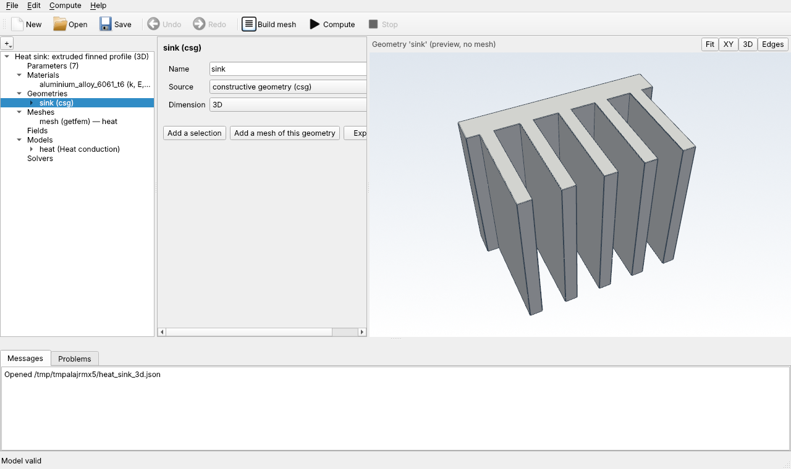
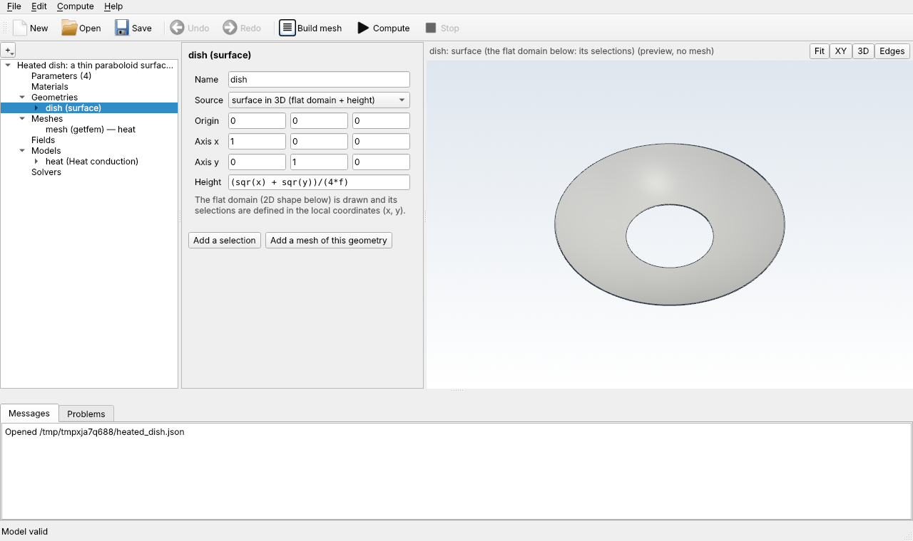

.. include:: ../replaces.txt

.. highlight:: json

.. _gui-geometries:

Geometries
==========

A geometry is given by its *source* (see :ref:`gui-ref-sources` for all
the fields):

``box``
   a segment, a rectangle or a box (1D, 2D, 3D), with the built-in
   selections of its sides ``xmin``, ``xmax``, ``ymin``... A box gets a
   structured mesh.
``csg``
   a constructive geometry: primitives (rectangles, disks, ellipses,
   polygons in 2D; boxes, balls, cylinders, extrusions and revolutions of 2D
   profiles in 3D) combined by unions, intersections and differences.
``curve``
   a chain of segments and arcs of circle in 2D or 3D (beams, cables).
``surface``
   a surface in 3D: a flat 2D domain placed in space, plus a height along
   its normal (shells, membranes).
``swept_surface``
   a 2D curve extruded along z or turned about the z axis.
``cad``
   a STEP, IGES or BREP file, read by |gmsh| (OpenCASCADE).
``mesh_file``
   a |gmsh| mesh (``.msh``), which is the geometry itself; its named
   physical groups become selections.

Constructive geometries in 2D
-----------------------------

A ``csg`` geometry is a tree of shapes, shown under the geometry in the
model tree. A boolean combines the first of its shapes with the following
ones (the difference subtracts them all from the first one)::

  {"type": "csg", "dim": 2, "shape":
    {"type": "difference", "of": [
      {"type": "rectangle", "min": [0, 0], "max": ["L", "H"]},
      {"type": "ball", "center": [0, 0], "radius": "a"}]}}

The primitives (:ref:`gui-ref-shapes`) are:

* ``rectangle``: lower and upper corners;
* ``ball`` (a disk in 2D): center and radius;
* ``ellipse``: center, semi-axes, angle of the first semi-axis in degrees;
* ``polygon``: its vertices, in either order, not necessarily convex (but
  it must not cross itself). Its vertices are edited in a table: *Insert*
  adds a vertex in the middle of a side, *Remove* removes one.

Every number may be a parameter or an expression of parameters. The type
of a primitive can be changed in its form: a rectangle or a disk changed
into a polygon keeps its corners (an octagon for a disk), a disk changed
into an ellipse keeps its center and radius.

The 2D geometries are drawn exactly, without meshing. Their boundary is
made of the *sides* of the primitives: ``xmin``, ``xmax``, ``ymin``,
``ymax`` for a rectangle, ``circle`` for a disk, ``ellipse``, and ``side1``,
``side2``... for a polygon (from its first vertex). The selections refer to
these sides (see :ref:`gui-selections`), so that they follow the changes of
the geometry.

Drawing
^^^^^^^

With a 2D geometry selected, the tools of the view draw a shape by
dragging, snapped to a grid whose step follows the zoom:

* *Rectangle*: from corner to corner;
* *Disk*: from the center to a point of the circle;
* *Ellipse*: the ellipse inscribed in the rectangle of two corners;
* *Polygon*: a vertex per click; clicking the first vertex again,
  double-clicking or *Enter* closes it, *Backspace* removes the last vertex.

The shape is added to, subtracted from or intersected with the geometry
(*Escape* stops drawing). It joins the root boolean of the tree when it is
the same operation; otherwise, the root is wrapped in a new boolean. A box
becomes a ``csg`` geometry on the first drawing: its sides become
selections of the same name, so that their uses stay valid.

Handles
^^^^^^^

.. image:: images/polygon_handles.png
   :width: 100%
   :alt: The handles of a polygon

With a primitive selected in the tree, its handles move or resize it,
snapped to the grid: corners and center of a rectangle; center and a point
of the circle of a disk; center and the ends of the two semi-axes of an
ellipse (the first one turns it); vertices, middles of the sides and center
of a polygon (dragging the middle of a side adds a vertex). A value that is
a number is changed; a value that is the name of a parameter changes the
parameter (dragging the circle of the hole of
``examples/plate_hole_tension.json`` changes ``a``); a value given by an
expression (``"L/2"``) is locked, and the status bar says so.

Any shape of a boolean can be removed (right click); a boolean left with a
single shape is replaced by it.

Geometries in 3D
----------------

The 3D primitives are the ``rectangle`` (a box), the ``ball``, the
``cylinder`` (origin, axis, length, radius), and two shapes made of a 2D
profile, itself a 2D constructive tree edited under the shape:

* ``extrusion``: the profile, in the (x, y) plane, extruded along z between
  two values of z;
* ``revolution``: the profile, in the (r, z) half plane, turned about the z
  axis (its part with r < 0 is ignored).

3D geometries are previewed without meshing: the surface of each
primitive is clipped to its part on the boundary of the whole shape, so
that the faces stay flat and the edges sharp. Their *faces* are those of
the primitives: ``xmin``... ``zmax`` of a box, ``sphere``, the ``side`` and the
ends ``start`` and ``end`` of a cylinder, ``bottom`` and ``top`` of an
extrusion, and the face swept by each side of the profile of an extrusion
or a revolution. They are picked in the view to define selections (see
:ref:`gui-selections-faces`). See ``examples/heat_sink_3d.json`` and
``examples/pulley_3d.json``.

Curves and surfaces
-------------------

Beams, cables, shells and membranes are geometries of a lower dimension
than their space:

``curve`` (2D or 3D)
   The points of the curve are given in a table: from each point, a segment
   goes to the next one, or an arc of circle if a point it goes through is
   given in the last column. A closed curve joins its last point to the
   first one. The ends of an open curve are the built-in selections
   ``start`` and ``end``.
``surface`` (3D)
   A flat domain, a 2D constructive tree drawn and edited as a 2D geometry
   (the *Flat domain* node), placed by an origin and two axes, plus a height
   along the normal: a number or an expression of the local coordinates
   ``x``, ``y`` and of the parameters (``"(sqr(x) + sqr(y))/(4*f)"``). Its
   selections are those of the flat domain (edges, regions, criteria in
   the local coordinates).
``swept_surface`` (3D)
   A 2D curve given as for ``curve``, extruded along z between two values,
   or turned about the z axis between two angles (the curve must then not
   touch the axis).

Their meshes are built by the meshing script (see :ref:`gui-meshes`) and
the models use them as any mesh, the gradients being then tangential. The
modules for beams and shells are to come. See ``examples/heated_dish.json``.

CAD files and meshes
--------------------

A ``cad`` geometry reads a STEP, IGES or BREP file with |gmsh|; it is meshed
by |gmsh| or Netgen. |gmsh| keeps the units of the file (often millimeters).
A ``mesh_file`` geometry is a ``.msh`` mesh, imported as it is (the
``import`` mesher); its named physical groups are selections.
