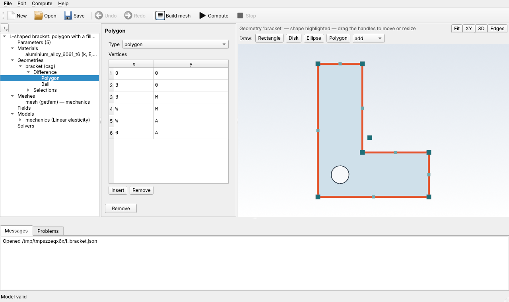
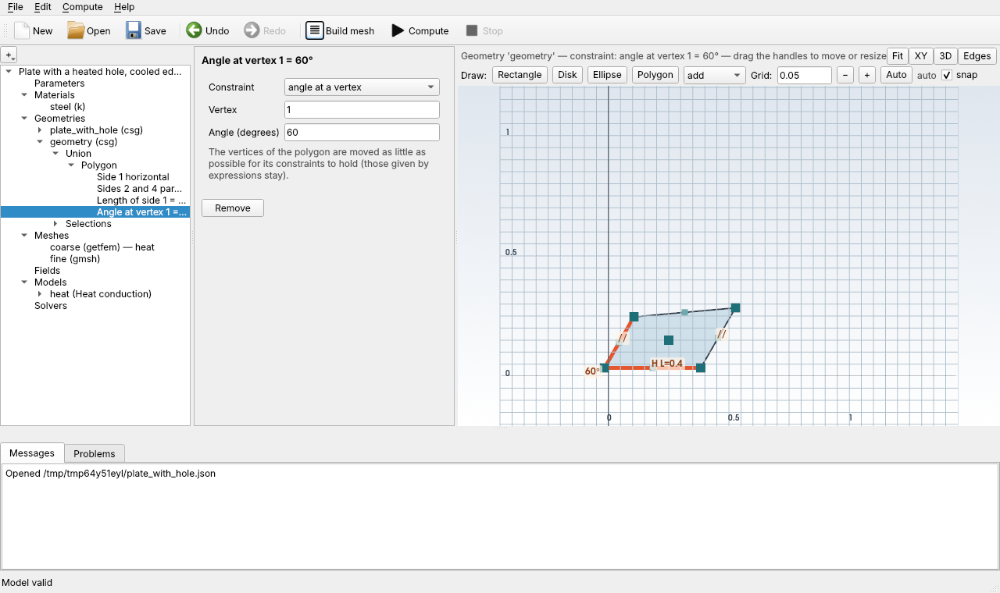
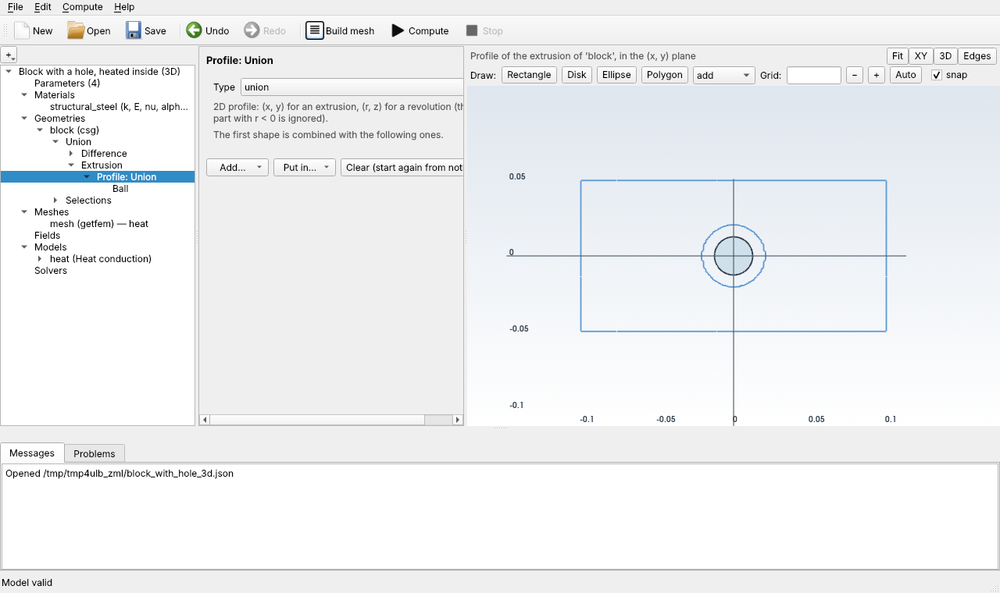
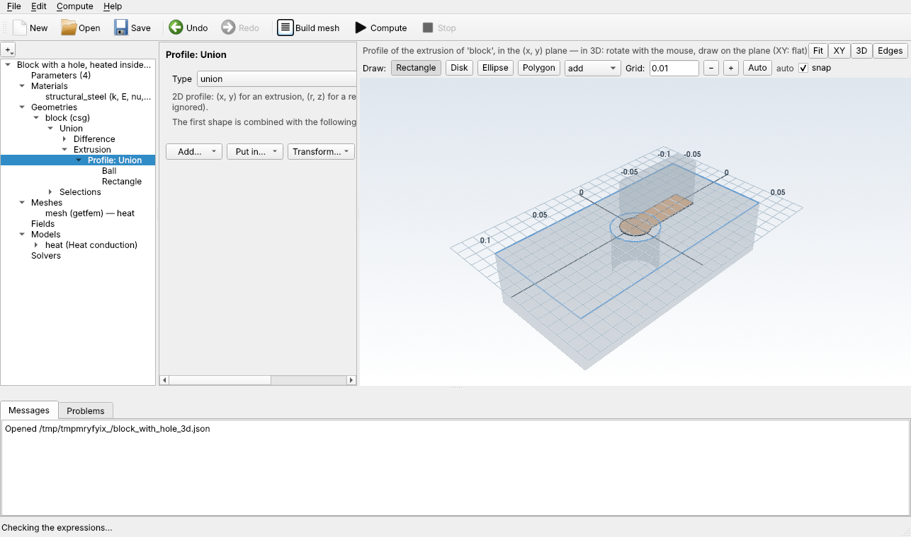
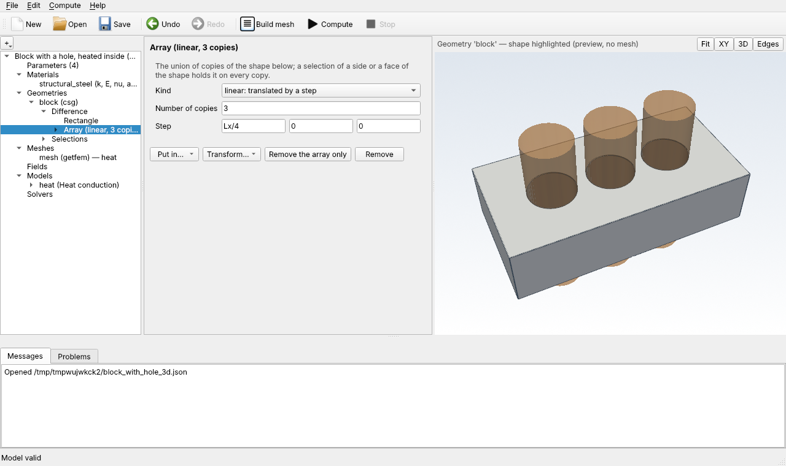

.. include:: ../replaces.txt

.. highlight:: json

.. _gui-geometries:

Geometries
==========

*Add a geometry* (the **+** button or a right click on *Geometries*) opens
a menu of the kinds of geometry: a segment, a rectangle or a box; a 2D
domain or a 3D solid by constructive geometry, an extrusion or a revolution
of a 2D profile; a curve in 2D or 3D, a surface in 3D, an extruded or
revolved curve; a CAD or a mesh file. A new box, curve or surface is a simple one of that
kind, to be edited; a new constructive geometry (2D domain, 3D solid) starts
from nothing, as does the profile of a new extrusion or revolution (see
:ref:`gui-geometries-building`), which is then selected: its 2D view, to
draw it. *Add a mesh of this geometry* gives it a
mesh. Its source can still be changed in its form.

A geometry is given by its *source* (see :ref:`gui-ref-sources` for all
the fields):

``box``
   a segment, a rectangle or a box (1D, 2D, 3D), with the built-in
   selections of its sides ``xmin``, ``xmax``, ``ymin``... A box gets a
   structured mesh.
``csg``
   a constructive geometry: primitives (rectangles, disks, ellipses,
   polygons in 2D; boxes, balls, cylinders, extrusions and revolutions of 2D
   profiles in 3D) combined by unions, intersections and differences.
``curve``
   a chain of segments and arcs of circle in 2D or 3D (beams, cables).
``surface``
   a surface in 3D: a flat 2D domain placed in space, plus a height along
   its normal (shells, membranes).
``swept_surface``
   a 2D curve extruded along z or turned about the z axis.
``cad``
   a STEP, IGES or BREP file, read by |gmsh| (OpenCASCADE).
``mesh_file``
   a |gmsh| mesh (``.msh``), which is the geometry itself; its named
   physical groups become selections.

Constructive geometries in 2D
-----------------------------

A ``csg`` geometry is a tree of shapes, shown under the geometry in the
model tree. A boolean combines the first of its shapes with the following
ones (the difference subtracts them all from the first one)::

  {"type": "csg", "dim": 2, "shape":
    {"type": "difference", "of": [
      {"type": "rectangle", "min": [0, 0], "max": ["L", "H"]},
      {"type": "ball", "center": [0, 0], "radius": "a"}]}}

The primitives (:ref:`gui-ref-shapes`) are:

* ``rectangle``: lower and upper corners;
* ``ball`` (a disk in 2D): center and radius;
* ``ellipse``: center, semi-axes, angle of the first semi-axis in degrees;
* ``polygon``: its vertices, in either order, not necessarily convex (but
  it must not cross itself), each one possibly rounded (see
  :ref:`gui-geometries-fillets`). Its vertices are edited in a table: *Add* adds
  one after the last, *Insert* adds a vertex in the middle of a side,
  *Remove* removes one. *Add a polygon* gives an empty polygon: the
  polygon tool of the view starts, and its vertices are clicked (as for
  drawing, below), in a 2D geometry as in the profile of an extrusion or
  a revolution; they can also be typed in the table.

Every number may be a parameter or an expression of parameters. The type
of a primitive can be changed in its form: a rectangle or a disk changed
into a polygon keeps its corners (an octagon for a disk), a disk changed
into an ellipse keeps its center and radius.

The 2D geometries are drawn exactly, without meshing. Their boundary is
made of the *sides* of the primitives: ``xmin``, ``xmax``, ``ymin``,
``ymax`` for a rectangle, ``circle`` for a disk, ``ellipse``, and ``side1``,
``side2``... for a polygon (from its first vertex). The selections refer to
these sides (see :ref:`gui-selections`), so that they follow the changes of
the geometry.

Drawing
^^^^^^^

With a 2D geometry selected, the tools of the view draw a shape by
dragging, snapped to a grid whose step follows the zoom:

* *Rectangle*: from corner to corner;
* *Disk*: from the center to a point of the circle;
* *Ellipse*: the ellipse inscribed in the rectangle of two corners;
* *Polygon*: a vertex per click; clicking the first vertex again,
  double-clicking or *Enter* closes it; a click of the middle button puts
  the last vertex and closes it. *Backspace* removes the last vertex; a
  right click proposes to remove the vertex clicked (or the last one), to
  close the polygon or to start it again.

The middle and right buttons still pan and zoom the view when they are
dragged: only their clicks (without moving) do these things.

A 2D geometry is shown with the x and y axes and the coordinates of their
main lines; while drawing, the view also shows the grid. The step of the grid follows the zoom
(*Auto*), or is set: **−** and **+** give the next finer or coarser round
step (1, 2, 5 × 10\ :sup:`n`), and a step can be typed in the *Grid* field.
The view keeps its zoom while the geometry is edited, unless the geometry
goes out of it (a shape moved by a transform, a value typed in a form): it
is then fitted to it again.
The points (and the handles, below) snap to it; *snap* unchecked, they go
anywhere. The grid is also shown, and set, while a primitive with handles
is selected.

The shape is added to, subtracted from or intersected with the geometry
(*Escape* stops drawing). Once a shape is drawn, its tool is released: a
click then grabs a handle (to move a vertex) instead of starting another
shape; the tool is pressed again for the next one. It joins the root boolean of the tree when it is
the same operation; otherwise, the root is wrapped in a new boolean. A box
becomes a ``csg`` geometry on the first drawing: its sides become
selections of the same name, so that their uses stay valid.

Handles
^^^^^^^

With a primitive selected in the tree, its handles move or resize it,
snapped to the grid: corners and center of a rectangle; center and a point
of the circle of a disk; center and the ends of the two semi-axes of an
ellipse (the first one turns it); vertices, middles of the sides and center
of a polygon (dragging the middle of a side adds a vertex). A value that is
a number is changed; a value that is the name of a parameter changes the
parameter (dragging the circle of the hole of
``examples/plate_hole_tension.json`` changes ``a``); a value given by an
expression (``"L/2"``) is locked, and the status bar says so.

A right click on a handle of a polygon proposes what applies to it: on a
vertex, to remove it, to round it (a fillet, see :ref:`gui-geometries-fillets`)
or to make it sharp again; on the middle of a side, to insert a vertex
there or to make the side curved (see :ref:`gui-geometries-splines`); on a
point of a curved side, to insert another one, to remove it or to make the
side straight; on the middle of an arc, to remove the fillet.

Any shape of a boolean can be removed (right click in the tree); a boolean
left with a single shape is replaced by it.

.. _gui-geometries-fillets:

Fillets
^^^^^^^

A vertex of a polygon is rounded by a *fillet*: an arc of circle of a given
radius, tangent to its two sides, that cuts a convex corner or fills a
reflex one (the inner corner of an L, where the stresses concentrate):

.. code-block:: text

  {"type": "polygon", "points": [...], "fillets": [{"vertex": 4, "radius": "Rf"}]}

The radius of each vertex is the last column (*fillet*) of the table of
the vertices (empty: a sharp corner); it may be a parameter. *Fillets:
round all the corners* puts a fillet on every vertex (a fifth of the
shortest side, to be changed), *Fillets: remove them* takes them off. With the polygon selected, a
handle in the middle of each arc changes its radius. A fillet too large for
its sides (the arcs of a side must not overlap) is an error of the polygon.
In the profile of a revolution, a vertex on the axis cannot be rounded: its
arc would be tangent to the axis, making a cusp of the solid there (an
error; *round all the corners* leaves these vertices sharp).

The arcs are sides of the polygon, ``fillet1``, ``fillet2``... (the number
of the vertex), selected as the other sides; the straight sides keep their
names, between the ends of the arcs. In a profile, they give the faces of
the extrusion or the revolution. The shape is exact for all the meshers:
lines and arcs of circle for |gmsh| and Netgen; for the GetFEM mesher, the
polygon cut or filled by disks and half planes (a reflex corner is filled
by a polygon going about h into the shape, the disk then taken away), the ends of the arcs being
given as vertices of the mesh (so that each face of the mesh lies on a side
or on an arc). See ``examples/l_bracket.json``.

.. _gui-geometries-splines:

Curved sides (splines)
^^^^^^^^^^^^^^^^^^^^^^

A side of a polygon can be curved: a cubic spline from its first vertex to
the next one, through points given in order. The vertices where the
boundary must be smooth (tangent) are listed in ``"smooth"``:

.. code-block:: text

  {"type": "polygon", "points": [...],
   "splines": [{"side": 2, "points": [[1.2, 0.35], [0.9, "y1"]]}],
   "smooth": [3]}

The spline goes through its points with a continuous curvature
(parametrized by the lengths of its chords). At a smooth vertex, its end
takes the direction of the straight side on the other side of the vertex
(two splines meeting there: the direction from the point before the vertex
to the point after it); otherwise the end is free (no curvature there).
The points may be parameters, as the vertices.

In the table of the vertices, the points of the spline of a side follow
its first vertex (rows ``2.1``, ``2.2``... for the side 2), and the third
column of the vertices at the ends of a curved side tells whether the
boundary is smooth there (a fillet cannot round them). *Curved* makes the
side after the selected vertex a spline, through a point a little off its
middle, or straight again; *Insert* and *Remove* act on the selected point
(a vertex inserted in a curved side is a point of its spline). In the view,
the points of the splines are handles; a right click on one inserts
another point after it, removes it or makes the side straight, a right
click on the middle of a straight side makes it curved, on a vertex at an
end of a curve makes it smooth or a corner. Removing a vertex next to a
curved side makes its two sides one curve, through it.

A curved side keeps its name (``side2``): it is selected as the other
sides and gives a face of the extrusion or the revolution. The shape is
exact for all the meshers: each spline is a chain of cubic Bezier curves,
given as such to |gmsh|, Netgen and the GetFEM mesher (its ``polygon``
object with curved sides, GetFEM patch "mesher: polygons with curved
sides"), the points of the splines being vertices of the mesh. The export
draws them as Bezier curves (SVG) or polylines (DXF). The constraints of a
polygon (below) only see its vertices; when they move them, the points of
a curved side follow: they are moved by the similarity (rotation, scaling,
translation) that takes the old segment between the ends of the side to
the new one, so that the curve keeps its shape relative to its ends (also
when a vertex of a constrained polygon is dragged).

.. _gui-geometries-constraints:

Constraints of a polygon
^^^^^^^^^^^^^^^^^^^^^^^^

A polygon drawn roughly is made exact by constraints (*Constrain…* on the
polygon): a horizontal or vertical side, the length of a side, the angle
between the two sides at a vertex, parallel or perpendicular sides, sides
of equal length, a vertex fixed at a point, a vertex on a vertex of
another polygon of the same tree. A new constraint holds as the polygon is
drawn (its value is measured, rounded; the side is the one that fits
best); its side, vertex or value are then changed in its form, or by
clicks in the view while it is selected: a side (or the handle in its
middle) for a constraint of a side; for two sides, the first click sets the
side, the next one the other side, and so on in turn; a vertex (its handle)
for a constraint of a vertex (a fixed vertex: fixed where it is). The values
may be parameters: ``"value": "L"`` makes the length follow ``L``. See
:ref:`gui-ref-constraints` for the keys.

The constraints are shown under the polygon in the tree, and by its sides
and vertices in the view (``H``, ``V``, ``//``, ``perp``, ``=``, ``L=…``,
the angle, ``fixed``, ``on``); a constraint selected highlights the sides it
refers to. The vertices given in the model are those of the drawing: they
are moved as little as possible (least squares) for the constraints to
hold, the vertices given by expressions of parameters staying where they
are; the polygons of a tree are solved together. Dragging a vertex moves it
as far as the constraints let it go, the other vertices following. A side
split by a new vertex (or two sides merged by the removal of a vertex) loses
its constraints; contradictory constraints are reported as an error of the
polygon.

.. _gui-geometries-building:

Building the tree
^^^^^^^^^^^^^^^^^

A new constructive geometry starts from nothing: its root is an empty union
(*Union (empty: add shapes)* in the tree, an error until a shape is added).
The actions of a shape node (right click, the **+** button, or the buttons
of its form) build the tree:

* on a boolean: *Add a rectangle*, *a ball*... (the primitives of its
  dimension), and *Add a union / an intersection / a difference*, an empty
  boolean to fill in turn;
* on any shape: *Put in a union / an intersection / a difference*, which
  makes it the first part of a new boolean (the other parts are then
  added to it);
* on any shape: *Transform: move or turn*, *Transform: copy in an array*
  (see :ref:`gui-geometries-transforms`);
* on the root (or a profile): *Clear (start again from nothing)*.

The type of a boolean is changed in its form (a union of a rectangle and a
disk becomes their difference). A boolean of a single shape is that shape;
an empty one is an error. In 2D, the first shape drawn on an empty geometry
becomes its first part. The selections that refer to sides or faces of
primitives follow these changes.

Geometries in 3D
----------------

.. image:: images/preview_3d.png
   :width: 100%
   :alt: The preview of an extruded heat sink

The 3D primitives are the ``rectangle`` (a box), the ``ball``, the
``cylinder`` (origin, axis, length, radius), and two shapes made of a 2D
profile, itself a 2D constructive tree edited under the shape:

* ``extrusion``: the profile, in the (x, y) plane, extruded along z between
  two values of z;
* ``revolution``: the profile, in the (r, z) half plane, turned about the z
  axis (its part with r < 0 is ignored).

The profile node, or one of its shapes, selected in the tree shows the
profile in its plane, (x, y) or (r, z), as a 2D geometry: shapes are drawn
in it (they go to the profile), the primitives have their handles, and the
vertices of a new polygon are clicked. The extrusion or revolution node
shows the 3D shape.

3D geometries are previewed without meshing: the surface of each
primitive is clipped to its part on the boundary of the whole shape, so
that the faces stay flat and the edges sharp. Their *faces* are those of
the primitives: ``xmin``... ``zmax`` of a box, ``sphere``, the ``side`` and the
ends ``start`` and ``end`` of a cylinder, ``bottom`` and ``top`` of an
extrusion, and the face swept by each side of the profile of an extrusion
or a revolution. They are picked in the view to define selections (see
:ref:`gui-selections-faces`). See ``examples/heat_sink_3d.json`` and
``examples/pulley_3d.json``.

.. _gui-geometries-work-planes:

Work planes
-----------

By default, the profile of an extrusion is in the (x, y) plane and the
extrusion goes along z; that of a revolution is in the (r, z) half plane
and turns about the z axis. Its *Work plane* (in its form) can also be
any plane: an origin and two axes x and y (the second one is made
orthogonal to the first one), the profile being drawn in their
coordinates, z along their cross product. A revolution then turns about
the z axis of its plane:

.. code-block:: text

  {"type": "extrusion", "z": [0, 0.02], "origin": [0.1, 0.05, 0.05],
   "axes": [[1, 0, 0], [0, 1, 0]], "profile": {...}}

**On a face.** On a 3D boolean (the root of a solid, say), *On a face…*
puts an extrusion on a plane face clicked in the view: *a boss*, out of the
face (united with the solid), or *a pocket*, into the solid (subtracted
from it). The boolean is put in a union (a difference) first when it is
not one. The work plane is that of the face (its origin at the center of
the visible part of the face, its normal outward), the depth a fifth of the
size of the solid, and the profile starts from nothing: it is shown in its
plane, where it is drawn (*Escape* cancels the choice of the face).

**The section under a profile.** The profile of an extrusion or a
revolution is shown on the section of the rest of the geometry by its plane
(just behind the plane for an extrusion, so that the face it stands on
shows; the (r, z) half plane for a revolution), in blue.

**In 3D.** With a profile shown, the **3D** button of the view shows it on
its plane in the 3D view, in the rest of the geometry (translucent; for a
revolution, the geometry around its (r, z) half plane): the view turns with
the mouse, the grid and the axes are those of the plane, and the shapes
are drawn on the plane as in 2D (a click is taken where its ray meets the
plane), with the same tools, handles and snapping. **XY** shows it flat
again. The choice is kept from a profile to the next one.

**Snapping.** While drawing or dragging a handle in 2D, a point within a
few pixels of a vertex snaps to it: corners and centers of the primitives,
vertices of the polygons, points where sides cross, corners of the section
under a profile; otherwise it snaps to the grid (*snap* unchecked: neither).

The GetFEM mesher places the shapes with its ``placed`` object (a rigid
motion, added to GetFEM for the interface); Gmsh and Netgen turn and move
them; a mesh in layers is turned and moved after it is built.

.. _gui-geometries-transforms:

Transformations and arrays
--------------------------

Any shape of a constructive geometry, 2D or 3D (a primitive, a boolean, a
profile or one of its shapes), can be moved or copied. *Transform* (right
click, the **+** button or the buttons of its form) puts it in a new node:

``transform``
   the shape turned by ``angle`` degrees about ``center`` (in 3D, about the
   line through ``center`` along ``axis``, counterclockwise around it), then
   translated by ``translate``. A new transform moves nothing and turns
   about the center of the shape;
``array``
   the union of ``count`` copies of the shape (itself included):
   ``linear``, each copy translated by ``step`` from the previous one;
   ``circular``, each copy turned by ``angle`` degrees about ``center``
   (and ``axis`` in 3D). A new array is linear, of three copies side by
   side; its *Kind* changes it into a circular one, a quarter of a turn
   apart about the origin.

.. code-block:: text

  {"type": "array", "kind": "circular", "count": 6, "angle": 60, "center": [0, 0, 0],
   "axis": [0, 0, 1], "of": [{"type": "cylinder", ...}]}

All these values may be parameters or expressions (``"count": "n"``, a
vector parameter for ``step``), so that a pattern is changed in one place.
*Remove the transform only* (*the array only*) puts the shape back in its
place; removing the shape removes its transform too.

The sides and faces of a moved or copied shape keep their names and their
paths in the tree: a selection of a side or a face of the shape holds it on
every copy (the ``hole`` of the block above is the side of the three
holes), and the selections stay valid when the shape is put in a transform
or an array or taken out of it. A region (2D) is a region of the shape, in
any of its copies. The handles of a moved 2D primitive are where it is
drawn: dragging them changes the primitive before the transformation.

In 2D, the transformations are applied to the primitives themselves (a
turned rectangle is meshed as a polygon). In 3D, the GetFEM mesher places
each copy with its ``placed`` object, |gmsh| and Netgen turn and move them.
An extrusion or a revolution meshed in layers may be moved; copied in an
array, it is meshed as a whole (the layers are dropped). See
``examples/flange_2d.json`` and ``examples/pin_fin_heat_sink_3d.json``.

Curves and surfaces
-------------------

.. image:: images/surface.png
   :width: 100%
   :alt: A paraboloid dish: a flat annulus plus a height

Beams, cables, shells and membranes are geometries of a lower dimension
than their space:

``curve`` (2D or 3D)
   The points of the curve are given in a table: from each point, a segment
   goes to the next one, or an arc of circle if a point it goes through is
   given in the last column. A closed curve joins its last point to the
   first one. The ends of an open curve are the built-in selections
   ``start`` and ``end``.
``surface`` (3D)
   A flat domain, a 2D constructive tree drawn and edited as a 2D geometry
   (the *Flat domain* node), placed by an origin and two axes, plus a height
   along the normal: a number or an expression of the local coordinates
   ``x``, ``y`` and of the parameters (``"(sqr(x) + sqr(y))/(4*f)"``). Its
   selections are those of the flat domain (edges, regions, criteria in
   the local coordinates).
``swept_surface`` (3D)
   A 2D curve given as for ``curve``, extruded along z between two values,
   or turned about the z axis between two angles (the curve must then not
   touch the axis).

Their meshes are built by the meshing script (see :ref:`gui-meshes`) and
the models use them as any mesh, the gradients being then tangential. The
modules for beams and shells are to come. See ``examples/heated_dish.json``.

CAD files and meshes
--------------------

A ``cad`` geometry reads a STEP, IGES or BREP file with |gmsh|; it is meshed
by |gmsh| or Netgen. |gmsh| keeps the units of the file (often millimeters).
A ``mesh_file`` geometry is a ``.msh`` mesh, imported as it is (the
``import`` mesher); its named physical groups are selections.
