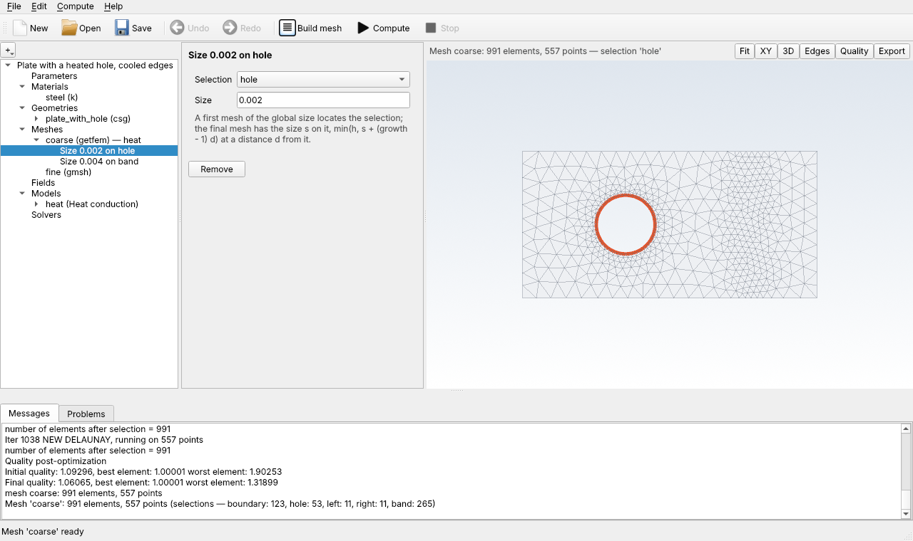
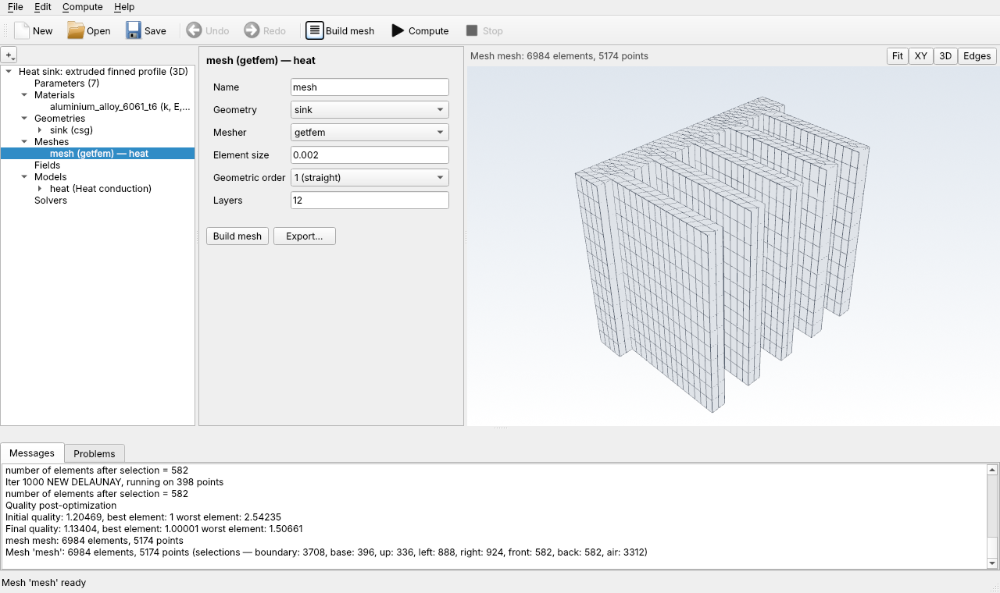
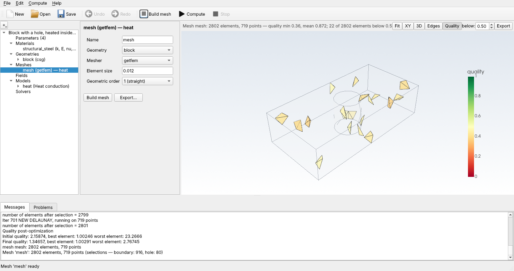

.. include:: ../replaces.txt

.. highlight:: json

.. _gui-meshes:

Meshes
======

A mesh belongs to a geometry, and is built by a *mesher*; several meshes
may be defined for one geometry, and the variables of the models say which
one they use. The meshers, the sources they accept and their fields are
listed in :ref:`gui-ref-meshers`.

``structured``
   a regular grid of a box: a number of divisions per direction, simplices
   or quadrilaterals / hexahedra.
``getfem``
   the experimental mesher of |gf| (``gf.MesherObject``, which needs |gf|
   built with Qhull), for boxes, constructive geometries, curves and
   surfaces: element size ``h`` and geometric order. In 2D, it follows the
   interfaces between the regions of a constructive geometry. It is slow in
   3D, and may lose thin or sharp details.
``gmsh``
   |gmsh| with OpenCASCADE (``pip install gmsh``), for boxes, constructive
   and CAD geometries and the flat domains of surfaces: element size and
   order. It is the default mesher of the new meshes of constructive and CAD
   geometries.
``netgen``
   Netgen with its own OpenCASCADE (``pip install netgen-mesher``): element
   size, order 1 or 2. It does not mesh ellipses and ellipsoids yet.
``import``
   a ``.msh`` file used as it is.

::

  {"name": "fine", "geometry": "plate", "mesher": "gmsh", "size": "L/40", "order": 2}

A new mesh of a box is structured; those of the other geometries use
|gmsh| (or the mesher chosen by ``GETFEM_GUI_DEFAULT_MESHER``). When a
geometry changes its kind of source, its meshes change their mesher if
needed, with an equivalent element size.

The **geometric order** 2 gives curved elements, which follow the circles
and the curved surfaces. They are drawn curved, the meshes as the results:
each face of an element is drawn in 4\ :sup:`n` triangles and each edge in
2\ :sup:`n` segments, placed (and colored, for a result) by the quadratic
interpolation, *n* being set by *Curved* in the bar of the view (shown for
such meshes; 2 by default, 0: straight elements through their corners).
The selections of a curved mesh are drawn refined as well.
The geometric order 3 (``getfem`` and ``gmsh`` meshers) follows the curved
boundaries more closely still; its elements are drawn by the same
quadratic interpolation.

.. _gui-meshes-sizes:

Local sizes
-----------

A mesh by the ``getfem``, ``gmsh`` or ``netgen`` mesher of a box, a
constructive geometry or a CAD file may be finer on parts of the domain:
*Add a local size* on the mesh gives a size to a selection (its edges, faces
or elements; any kind of selection), shown under the mesh in the tree::

   "sizes": [{"selection": "hole", "size": "h/5"}, {"selection": "band", "size": "h/2"}],
   "growth": 1.3

Away from a selection, the elements grow by the rate *Growth* (1.3: each
one at most 30 % larger than its neighbor): the size at a point is the
smallest of the size of the mesh *h* and of *s* + (growth − 1) *d* for each
local size *s*, *d* being the distance to its selection. The selections are
evaluated on a mesh, so the meshing script makes a first mesh of the global
size, locates the selections of the local sizes on it and samples them
(their faces or elements subdivided, about *s* apart), then makes the final
mesh with this size function: the GetFEM mesher with the sizes at these
points (``gf.Mesh('generate', ..., size_points, sizes, growth)``), Gmsh
with a size callback, Netgen with the sizes restricted at these points (its
grading follows the growth). The interfaces between regions followed by the
GetFEM mesher take the local sizes too.

.. _gui-meshes-refine:

Refinements
-----------

*Add a refinement* on a mesh (of a box, a constructive geometry, a CAD or
mesh file, not in layers) splits its elements, each time in 2\ :sup:`d`
(their size halved), which gives nested meshes (convergence studies)::

   "refine": [{"selection": "all", "times": 1}, {"selection": "hole", "times": 2}]

- on ``all``, the whole mesh, by its mesher: Gmsh and Netgen split their
  elements following the geometry; for the ``getfem`` mesher, GetFEM splits
  them and the new boundary nodes are projected on the geometry; a
  structured mesh gets 2\ :sup:`n` times more divisions; an imported mesh is
  split by GetFEM;
- on a selection, after the refinements of ``all`` and in their order: its
  elements (those along its faces for a selection of edges or faces), by
  GetFEM (Bank refinement: enough neighbors are split for the mesh to stay
  conforming; triangles and tetrahedra only). The selections are located on
  the mesh before these refinements, and refined with it. The new boundary
  nodes are projected on the geometry with the ``getfem`` mesher only (with
  Gmsh or Netgen, they stay on the chords of the curves).

A local size (above) gives a mesh that grows smoothly away from the
selection; a refinement keeps the elements of the first mesh, split.

Quadrangles and hexahedra
-------------------------

``"element": "quad"`` gives quadrangles in 2D with |gmsh| (Blossom
recombination then a subdivision: quadrangles only) or Netgen (quad
dominated), as well as for the flat domains of surfaces.

.. _gui-meshes-layers:

Meshes in layers
----------------

A 3D extrusion or revolution can be meshed **in layers**
(``"layers": n``, with any of the three meshers): its profile is meshed in
2D, then extruded or turned about the axis in *n* layers by |gf|
(``gf.Mesh('prismatic')``), which gives prisms, or hexahedra from
quadrangles. With a geometric order 2, the layers of a revolution are
curved. The profile of a revolution meshed in layers must not touch the
axis, and needs at least 3 layers.

Curves and surfaces
-------------------

A curve is meshed by elements of the element size, the nodes of the arcs
being on them; a surface by a mesh of its flat domain (with any 2D mesher),
mapped to 3D (curved with order 2); a swept surface by a mesh of its curve,
extruded or turned in layers (quadrangles).

Quality of the elements
-----------------------

*Quality*, in the bar of the view of a mesh, shows the quality of its
elements, from 0 (a flat or folded element, red) to 1 (the regular element
of its kind, green): the radius ratio *d r / R* of the triangles and
tetrahedra (*r* the radius of the inscribed circle or sphere, *R* that of
the circumscribed one, *d* the dimension: the inverse of the worst element
reported by the ``getfem`` mesher), the smallest scaled Jacobian at the
corners of the quadrangles, hexahedra, prisms and pyramids, relative to that
of the regular element (a square, a cube...). Curved elements are measured
by their corners. The elements of a plane or a surface are all colored, and
those below the threshold (*below*, 0.3 by default) outlined; in 3D only
the elements below the threshold are drawn, in the mesh made transparent.
The bar gives the minimum, the mean and the number of elements below the
threshold.

The cache
---------

A mesh is only rebuilt when its geometry, its parameters or its source file
change (a SHA-256 hash of them): changing the physics does not remesh. The
meshes and their selections are kept in ``<model>_work/meshes``. The
messages of the mesher appear in *Messages*; the number of elements of each
selection is given at the end.

Status
------

The ``structured``, ``getfem`` and ``import`` meshers are tested against
exact solutions. The scripts of |gmsh| and Netgen are tested where these
modules are installed.
