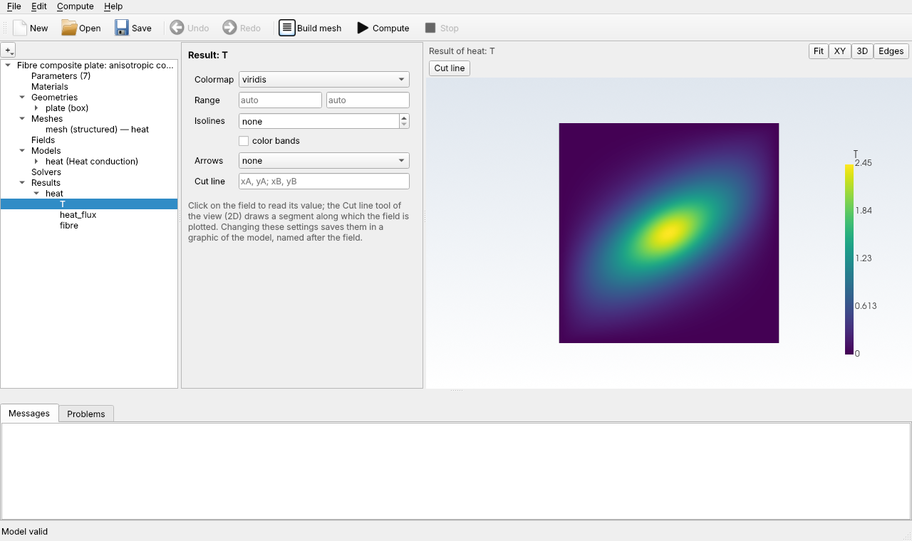

.. include:: ../replaces.txt

.. highlight:: json

.. _gui-models:

Models
======

A model is one ``gf.Model``: variables, modules, terms and conditions
solved together. A new model is created from a module (the **+** button on
the *Models* node), with its variables. The forms of its nodes are listed
in :ref:`gui-ref-nodes`.

Variables
---------

A variable has a name, a mesh, a finite element method (continuous or
discontinuous Lagrange), a degree, and is scalar or vector (as many
components as the dimension)::

  {"name": "u", "mesh": "mesh", "fem": "lagrange", "degree": 2, "components": "dim"}

Modules
-------

A module is a predefined physics acting on variables
(:ref:`gui-ref-modules`):

``heat_conduction``
   stationary heat conduction, of conductivity ``k``; conditions
   ``temperature``, ``heat_flux``, ``convection``; macro ``q`` (the heat
   flux). With its option ``"conductivity": "anisotropic"``, ``k`` is a
   matrix (see below).
``linear_elasticity``
   of Young's modulus ``E`` and Poisson's ratio ``nu``, in plane strain or
   plane stress in 2D; conditions ``fixed``, ``displacement``, ``roller``
   (``u.n = 0``, imposed by Nitsche's method, so that it may share nodes with
   a fixed condition), ``traction``, ``pressure``; macros ``eps``, ``sigma``,
   ``von_mises``...
``thermal_expansion``
   coupling of a temperature (a variable of the model, or imported from
   another model) with a linear elasticity module: it adds
   :math:`-\beta\alpha(T - T_{ref})I` to the stress.
``pde``
   a partial differential equation of a scalar or vector unknown, in
   coefficient or general form, of order 0, 1 or 2 in time (see below).

The form of a module is in sections, opened or closed by a click on their
title: *Equation* (the equation it solves, with the options which change
it: isotropic or anisotropic, plane strain or stress), *Variable* (the
variables of the model it acts on), *Parameters* (its **properties** and its
**source** :math:`f`, edited there) and *GWFL terms* (the terms that the
script adds for it, closed by default). A section opened or closed stays so
for the other modules; a section with a wrong field is shown open. The
properties are given per domain selection (*Add a domain
for k*: the last one listed wins), by a value (a number or an expression,
possibly of the variables: a conductivity ``k(T)`` makes the model
nonlinear) or by a material. The source is 0 by default, a value or an
expression of the coordinates, the time, the variables; *Add a domain for f*
gives sources on domain selections, which add up. Editing the domain or the
value of a property or of a source shows its domain in the view, where the
regions clicked are added to it (or removed). The **conditions** (nodes
below the module) apply on boundary selections. A boundary without condition is free (zero flux, zero
traction). The interface warns when nothing fixes the solution (no imposed
temperature, no displacement constraint).

Anisotropic properties
----------------------

Some properties are tensors for an option of their module: the
conductivity of a heat conduction module with ``"conductivity":
"anisotropic"`` is a matrix of the dimension of the space. Each of its
values is then ``[a, b; c, d]`` (by rows, as in GWFL), a matrix parameter, a
GWFL matrix expression, a list of rows in the file, or a number, standing
for that number times the identity; a material may give a matrix too.
Choosing ``anisotropic`` in the form of the module turns the numbers into
the matrices they stand for (``1`` becomes ``[1, 0; 0, 1]``), the field
being labelled as a matrix; back to ``isotropic``, a multiple of the
identity becomes a number again (an expression is left as it is). In
``examples/anisotropic_plate.json``, the conductivity tensor of a fibre
composite is built from the direction ``d`` of the fibres:

.. code-block:: text

  {"name": "K", "value": "[k1*sqr(d(1)) + k2*sqr(d(2)), (k1 - k2)*d(1)*d(2);
                           (k1 - k2)*d(1)*d(2), k1*sqr(d(2)) + k2*sqr(d(1))]"}

The heat conduction module can be *unfolded* (tree action) into the
equivalent terms and generic conditions, a starting point to write a
variant.

.. _gui-models-pde:

PDE module
----------

The ``pde`` module solves an equation given by its coefficients:

.. math::

   m \frac{\partial^2 u}{\partial t^2} + d \frac{\partial u}{\partial t}
   - \mathrm{div}(K \nabla u + b\, u - j) + v\cdot\nabla u + r u = f,

of coefficients ``K`` (the diffusion: a number or, with ``"diffusion":
"anisotropic"``, a matrix), ``b`` (a conservative convection, a vector),
``j`` (a given flux, a vector), ``v`` (the convection velocity, a vector),
``r`` (a reaction), ``d`` and ``m``, or in general form
(``"form": "general"``),

.. math::

   m \frac{\partial^2 u}{\partial t^2} + d \frac{\partial u}{\partial t}
   - \mathrm{div}\,F = f,

of flux ``F``: any expression of ``u`` and of its gradient,
``(1 + sqr(u))*Grad_u`` for instance (the model is then nonlinear, solved
by Newton's method). The coefficients are properties, given per domain
selection, and the expressions may depend on the coordinates, the time and
the variables; a zero coefficient adds no term to the script. The equation
shown in the form of the module has all the terms of its form and of its
order in time, whatever the values of the coefficients (and whatever the
global solvers, which decide whether it is solved in time). In the
expressions, the coefficients take the name of the unknown (given in the
help of their fields): ``K_u``,
``v_u``, ``F_u``... for an unknown ``u`` (renamed with it), so that they do
not clash with the parameters (a parameter ``r`` may be the value of
``r``) and that two PDEs of a model, on two unknowns, have their own
coefficients.

Its options:

- ``unknown``: ``scalar``, or ``vector`` (as many components as the
  dimension: changing it changes the variable). For a vector, ``K`` is the
  same for each component (a number or a matrix applied to the gradient of
  each one), ``r``, ``d``, ``m`` are matrices (a number standing for its
  multiple of the identity) coupling the components, ``j`` and ``F`` are
  matrices (a row per component, as ``Grad_u``), and there is no ``b``.
- ``time_order``: ``0``, ``1`` (:math:`d\,\partial u/\partial t`, as the
  heat), ``2`` (:math:`m\,\partial^2 u/\partial t^2`, a wave, and
  :math:`d` a damping, 0 by default). As for the other modules, the order
  is part of the equation, and whether it is solved in time, and with which
  scheme, is chosen in the global solver (:ref:`gui-time-schemes`): a
  stationary solver solves it with zero time derivatives.
- ``stabilization``: ``none`` or ``supg``, for a scalar unknown in
  coefficient form. When the convection dominates (:math:`|v| h / K`
  large, h the size of the elements), the Galerkin solution oscillates;
  SUPG adds to the equation, on each element,
  :math:`\tau\,(v\cdot\nabla w)\,R(u)` with :math:`w` the test function,
  :math:`R(u)` the residual of the equation (its second derivatives from
  degree 2, the gradient of :math:`K` neglected) and
  :math:`\tau = ((2|v|/h)^2 + 9 (4K/h^2)^2)^{-1/2}`, h the size of the
  element divided by the degree of the unknown. It is consistent: the
  exact solution satisfies it.

Its conditions: ``imposed_value``, ``flux`` (:math:`F\cdot n = g`, with
:math:`F = K \nabla u + b\, u - j` in coefficient form, the flux of the
general form otherwise) and ``robin`` (:math:`F\cdot n = g - q u`); a
boundary without condition has a zero flux. The macro ``F_u`` is the flux
in coefficient form, exported as the field ``flux`` for a scalar unknown.
``examples/convection_diffusion.json`` and ``examples/membrane_wave.json``
use it.

Materials
---------

*Add from a library* (on the *Materials* node, a menu by category) copies a
material of the built-in library (:ref:`gui-ref-materials`) or of your own
library (``~/.config/getfem_gui/materials.json``, or the file given by
``GETFEM_GUI_MATERIALS``); a material of the model is added to your library
by *Save in my library*. Only the copies are in the model file, with their
origin, and they may be changed. The *Materials* node shows a table of the
materials and of the properties asked by the modules of the file.

Terms
-----

A term is a GWFL weak form integrated on a selection. The terms of a model
sum to zero: a source is written ``"-f*Test_u"``::

  {"name": "extra", "expr": "-q0*Test_T", "selection": "inclusion"}

A term that |gf| does not accept as linear is added as a nonlinear one, and
the model is then solved by Newton's method.

Generic conditions
------------------

Conditions on any variable (:ref:`gui-ref-conditions`): ``dirichlet``
(by simplification, multipliers or penalization), ``normal_dirichlet``,
``neumann``, ``robin``.

Solvers
-------

The solver of a model is ``auto`` (linear or Newton, depending on the
terms), ``linear`` or ``newton`` (maximum number of iterations, residual
tolerance). For a linear model, the solve script checks the relative
residual :math:`|KU - F|/|F|` and stops with an explicit error when it
exceeds :math:`10^{-6}` (a singular system); when the system is singular but
compatible, it is solved, with a warning.

The **linear solver** of a model solves its linear systems (the system of a
linear model, the one of each Newton iteration otherwise): ``auto`` (GetFEM's
choice: a direct solver up to a size, then an iterative one), a direct one
(``mumps``, SuperLU if this GetFEM has no MUMPS, with a warning;
``superlu``; ``dense_lu``, for small systems only) or an iterative one with
an incomplete factorization as preconditioner (``cg/ildlt``,
``gmres/ilu``, ``gmres/ilut``, ``gmres/ilutp``). The conjugate gradient
requires a symmetric positive definite system: no multiplier, and no
Dirichlet condition by simplification (it makes the system non
symmetric). For a linear model, the maximum number of iterations of an
iterative solver is at least 10000; when it does not reach the residual
check above, the error says so (choose a direct solver or another
preconditioner).

Several models are solved by a global **solver**: ``sequence`` (in order),
or ``staggered`` (iterated until the relative change of the variables is
below a tolerance, with relaxation). A model takes a variable of another one
by an **import**, on the same mesh for now::

  {"name": "T", "model": "thermal", "variable": "T"}

Without a global solver, the models are solved in an order compatible with
their imports. See ``examples/thermoelastic_plate.json``.

**Several global solvers** run one after the other (*Compute*), in the
order of the list. Each one starts from the initial values of the
variables (``"start": "initial"``, the default) or from the state left by
the solver before it (``"start": "previous"``: the values of the variables
and the velocities of those in time; the first solver starts from the
initial values). A static preload, then a dynamics:

.. code-block:: text

  "solvers": [
    {"name": "static", "type": "sequence", "steps": ["beam"]},
    {"name": "preloaded", "type": "transient", "start": "previous", "steps": ["beam"],
     "time": {"end": 0.4, "step": 0.02}, "schemes": {"beam/u": {"type": "newmark"}}}]

The beam starts at the static equilibrium (its initial acceleration, from
the equation, is zero) and stays there. Each solver has its results, in
its folder (``static/``, ``preloaded/``): *Compute* shows those of the last
one, and the results offer those of each solver computed (*Results of the
solver ...*). *Compute this solver* (the menu of a solver) runs one of
them, after those it starts from. A variable may be in time for a solver
and stationary for another: its time derivatives (``Dot_u``) are zero
there. The script then has a function per solver; ``python script.py``
runs them all, ``python script.py --solver preloaded`` one of them (after
those it starts from).

A step may also solve **some of the variables of a model**: ``"model/u"``
(or ``"model/u,p"``) solves ``u`` (and ``p``), the other variables of the
model being given, their current values (a partial resolution). A coupled
model can thus be solved in sequence, ``["coupled/T", "coupled/u"]`` (a
one-way coupling: the temperature, then the displacement it causes), or by
staggered iterations between its variables, without splitting it into
several models; each variable of a model is solved by one step at least.
The *Steps* of the solver offer each model and each variable of a model
that has several. In the script, the given variables are disabled during
the step (``disable_variable``), with the multipliers of their Dirichlet
conditions; a disabled variable is a data: its coupling terms go to the
right-hand side.

The properties of the modules are data of the model: a property given by
two modules of a model (the density ``rho`` of a heat conduction and of an
elasticity) is the same data, defined once (the two definitions, when both
are used, must be the same).

Transient problems
------------------

A ``transient`` global solver solves its models in time, from a start time
to an end time by a fixed time step::

  {"name": "heating", "type": "transient", "steps": ["heat"],
   "time": {"start": 0, "end": 60, "step": 1}, "save": {"every": 5},
   "coupling": "sequence", "schemes": {"heat/T": {"type": "bdf2"}}}

Whether a variable is solved in time, and how, is a choice of the solver,
not of the physics: the same model may be solved stationary by one solver
and in time by another. The solver lists the variables of its models which
may have a time derivative (those of the modules with one: the temperature
of a heat conduction, first order; the displacement of a linear elasticity,
second order) and gives each one its **time scheme** (``schemes``, keyed by
``model/variable``; its form shows a *Scheme of T* choice for each, and the
parameters of the scheme):

- ``{"type": "stationary"}``: no time derivative, the equation solved at
  each time step (quasi-static: a heat conduction following imposed values
  that depend on the time, an elasticity driven by a temperature in time);
- first order (the heat):

  - ``{"type": "theta", "theta": 1}``: the :math:`\theta`-method,
    :math:`\theta = 1` implicit Euler (the default), :math:`\theta = 1/2`
    Crank-Nicolson;
  - ``{"type": "bdf2", "start": "implicit_euler"}``: BDF2, second order,
    its first step by implicit Euler (the default: monotone) or by
    Crank-Nicolson (``"crank_nicolson"``: a smaller error, but it may
    overshoot when the initial values do not satisfy the conditions);

- second order (the elastodynamics):

  - ``{"type": "newmark", "beta": 0.25, "gamma": 0.5}``: Newmark's scheme,
    by default the average acceleration (second order, unconditionally
    stable, no numerical damping: the energy is conserved; the default);
  - ``{"type": "hht", "alpha": -0.05}``: HHT-:math:`\alpha`
    (Hilber-Hughes-Taylor), :math:`\alpha \in [-1/3, 0]`: second order,
    unconditionally stable, a numerical damping of the high frequencies
    growing as :math:`\alpha` decreases (:math:`\alpha = 0`: the average
    acceleration);
  - ``{"type": "generalized_alpha", "rho_inf": 0.8}``: the
    generalized-:math:`\alpha` scheme (Chung and Hulbert), given by the
    spectral radius at infinity :math:`\rho_\infty \in [0, 1]`: second
    order, unconditionally stable, the optimal damping of the high
    frequencies for a given accuracy of the low ones (:math:`\rho_\infty =
    1`: the average acceleration, no damping; :math:`\rho_\infty = 0`: the
    high frequencies damped at once);
  - each with ``"initial_acceleration"``: ``"equation"`` (the default:
    from the equation at the start time, :math:`M a_0 = -G(u_0, v_0,
    t_0)`) or ``"zero"`` (at rest).

In time, the heat conduction adds :math:`\rho c_p \partial T/\partial t`
(the term ``rho*cp*Dot_T*Test_T``), and its properties ``rho`` and ``cp``
are then required; the linear elasticity adds the inertia :math:`\rho
\partial^2 u/\partial t^2` (``rho*u__inertia.Test_u``, see below) and,
optionally, a Rayleigh damping :math:`\alpha_M M + \beta_K K`: its
properties ``rho``, ``alpha_M`` (1/s) and ``beta_K`` (s; 0 by default, no
term then) are then required. These properties are not needed otherwise;
they are given a default value when the variable goes into time. The form
of the module shows where it stands: stationary, or in time with its
scheme, and the equation solved. ``Dot_T``, ``Previous_T``, ``Dot_u``,
``Dot2_u``, ``Previous_Dot_u``... may appear in the terms and the outputs
of the model (at a saved time, ``Dot_u`` and ``Dot2_u`` in an output are
the derivatives at that time: a kinetic energy ``0.5*rho*Dot_u.Dot_u``; at
the start time, a first derivative is the initial one when the scheme
computes it, 0 otherwise). Since every equation is
written at the new time (see :ref:`gui-time-schemes`), variables with
different schemes and stationary variables are solved together without
difficulty, in one model or in coupled ones.

- The variables start from their **initial** value (a number or an
  expression of the coordinates and the parameters; 0 by default) and,
  second order in time, their **initial velocity** (``initial_velocity``,
  0 by default).
- The time ``t`` may appear in the expressions (sources, conditions,
  terms): the imposed values depending on it are interpolated again at
  each time step.
- At each time step, the models of the solver are solved in turn
  (``coupling``: ``sequence``) or by staggered iterations (``staggered``,
  with ``max_iter``, ``tolerance``, ``relaxation``), each one taking the
  current variables of the others by its imports; a model without time
  derivative (an elasticity) is then quasi-static.
- The time step is the same for all the variables of a solver.
- The results are saved every ``save.every`` steps and at the end: a |vtu|
  file each (``heat_00005.vtu``...), a ParaView collection ``heat.pvd``,
  and the scalar results (outputs, extrema) as series of the saved times
  (``series`` in the results); the final values are those shown as for a
  stationary model.

See ``examples/plate_heating.json`` and ``examples/beam_vibration.json``.

.. _gui-time-schemes:

Time schemes: principle and implementation
------------------------------------------

**The principle.** Once discretized in space, a model in time is a system

.. math::

   M \dot U + F(U, t) = 0,

where :math:`M` comes from the time derivative terms (the "mass": :math:`\rho
c_p` for the heat) and :math:`F` gathers all the other terms: conduction,
sources, boundary conditions, nonlinear terms, constraints, the equations
of the stationary variables. The scheme does not touch :math:`F`: at each
time step, the equation is written **at** :math:`t_{n+1}`, as a stationary
problem,

.. math::

   M \dot U_{n+1} + F(U_{n+1}, t_{n+1}) = 0,

and the scheme only gives :math:`\dot U_{n+1}` as a function of the unknown
:math:`U_{n+1}` and of the values of the previous steps. No term of
:math:`F` is weighted one by one (no "dispatcher" of terms): the conditions
are imposed at :math:`t_{n+1}`, a nonlinear model is solved by Newton's
method as in the stationary case, the right-hand side stays as it is. The
schemes of the different variables are thus independent: each variable in
time has its own expression of its derivative, the stationary ones none.

The schemes of first order equations all have the form

.. math::

   \dot U_{n+1} = \frac{c_0 U_{n+1} + c_1 U_n + c_2 U_{n-1}}{\Delta t}
   + c_3 \dot U_n .

- The :math:`\theta`-method, :math:`(U_{n+1} - U_n)/\Delta t = \theta \dot
  U_{n+1} + (1 - \theta) \dot U_n`: :math:`(c_0, c_1, c_2, c_3) = (1/\theta,
  -1/\theta, 0, -(1 - \theta)/\theta)`. Since the equation also held at
  :math:`t_n`, this is the usual :math:`\theta`-method :math:`M (U_{n+1} -
  U_n)/\Delta t + \theta F_{n+1} + (1 - \theta) F_n = 0`. :math:`\theta = 1`
  is the implicit Euler scheme (first order, robust: the default);
  :math:`\theta = 1/2` Crank-Nicolson (second order, but it may oscillate
  with steep initial data); :math:`\theta < 1/2` is only conditionally
  stable.
- BDF2, :math:`\dot U_{n+1} = (3 U_{n+1} - 4 U_n + U_{n-1})/(2 \Delta t)`:
  :math:`(3/2, -2, 1/2, 0)`. Second order and L-stable (no oscillation, it
  damps the fast modes), with an error constant larger than that of
  Crank-Nicolson. It needs two previous values: its first step is an
  implicit Euler one, :math:`(1, -1, 0, 0)` (the default), or a
  Crank-Nicolson one, :math:`(2, -2, 0, -1)`. Both keep the second order:
  the local error of a single step, :math:`O(\Delta t^2)` for implicit
  Euler, :math:`O(\Delta t^3)` for Crank-Nicolson, is made once. Implicit
  Euler is monotone: with initial values that do not satisfy the conditions
  (a temperature imposed at once on a side), Crank-Nicolson overshoots
  (above the imposed value) on its step, then BDF2 damps it.

When the first step needs the initial derivative :math:`\dot U_0`
(:math:`c_3 \neq 0`: :math:`\theta < 1`, BDF2 started by Crank-Nicolson), it is
computed first from the
equation at :math:`t_0` (an implicit Euler step of a tiny time step from the
initial values).

**Second order equations** (the elastodynamics), :math:`M \ddot U + G(U,
\dot U, t) = 0`, :math:`G` gathering all the terms but the inertia
(stiffness, damping, loads, conditions). Newmark's relations give the
acceleration and the velocity at :math:`t_{n+1}` as functions of the
unknown :math:`U_{n+1}` and of :math:`U_n, V_n, A_n`:

.. math::

   A_{n+1} = \frac{U_{n+1} - U_n}{\beta \Delta t^2} - \frac{V_n}{\beta \Delta
   t} - \frac{1 - 2\beta}{2\beta} A_n, \qquad V_{n+1} = V_n + \Delta t
   \left((1 - \gamma) A_n + \gamma A_{n+1}\right),

and Newmark's scheme is the equation written at :math:`t_{n+1}`, :math:`M
A_{n+1} + G_{n+1} = 0`. The generalized-:math:`\alpha` scheme (and HHT,
:math:`\alpha_m = 0`, :math:`\alpha_f = -\alpha`) weights the terms
between the two times:

.. math::

   M \left((1 - \alpha_m) A_{n+1} + \alpha_m A_n\right) + (1 - \alpha_f)
   G_{n+1} + \alpha_f G_n = 0 .

It is written at :math:`t_{n+1}` too, without assembling :math:`G_n` again:
with a **memory** :math:`m_n` such that :math:`G_n = -M m_n`, dividing by
:math:`1 - \alpha_f`,

.. math::

   M \tilde A_{n+1} + G_{n+1} = 0, \qquad \tilde A_{n+1} = \frac{(1 -
   \alpha_m) A_{n+1} + \alpha_m A_n - \alpha_f m_n}{1 - \alpha_f},

and the same equation gives :math:`G_{n+1} = -M \tilde A_{n+1}`: the
memory is updated by :math:`m_{n+1} = \tilde A_{n+1}`. Only the inertia
term changes (its acceleration :math:`\tilde A`, the "modified
acceleration"), :math:`G` is written at :math:`t_{n+1}` as for a
stationary problem; this is exactly the standard scheme, also for a
nonlinear :math:`G` and loads depending on the time (they end up weighted
by :math:`1 - \alpha_f` and :math:`\alpha_f`), provided that the mass
:math:`M` does not change with the time and that the memory starts from
:math:`m_0 = A_0`, the acceleration of the equation at :math:`t_0`. The
parameters: HHT, :math:`\beta = (1 - \alpha)^2/4`, :math:`\gamma = 1/2 -
\alpha`; generalized-:math:`\alpha` from :math:`\rho_\infty`,
:math:`\alpha_m = (2\rho_\infty - 1)/(\rho_\infty + 1)`, :math:`\alpha_f =
\rho_\infty/(\rho_\infty + 1)`, :math:`\gamma = 1/2 - \alpha_m +
\alpha_f`, :math:`\beta = (1 - \alpha_m + \alpha_f)^2/4`.

**The initial acceleration** :math:`A_0` solves :math:`M A_0 = -G(U_0, V_0,
t_0)`: the residual :math:`r = -G` is assembled without inertia at the
initial values, then :math:`(M/\varepsilon^2 + K) \, \delta = r`
(:math:`\varepsilon = 10^{-6} \Delta t`, :math:`K` the tangent matrix of
:math:`G`) gives :math:`\delta = \varepsilon^2 A_0 + O(\varepsilon^4)`,
without any difference of values (no cancellation), the conditions taken
into account by the system. ``"initial_acceleration": "zero"`` starts at
rest instead.

**The implementation.** The scheme is written in the script with GWFL macros
and data of the model, updated by the time loop (they can be read in the
exported script):

- ``T__prev``, ``T__rate`` and, for BDF2, ``T__prev2`` (data on the finite
  element method of ``T``): :math:`U_n`, :math:`\dot U_n`, :math:`U_{n-1}`;
  ``T__scheme``: the coefficients :math:`(c_0, c_1, c_2, c_3)` of the
  current step.
- Second order: ``u__prev``, ``u__rate``, ``u__rate2`` and, for HHT and
  generalized-:math:`\alpha`, ``u__mem`` (:math:`U_n, V_n, A_n, m_n`); the
  macros ``Dot2_u`` (``u__acc(1)*(u - u__prev)/sqr(timestep) +
  u__acc(2)*u__rate/timestep + u__acc(3)*u__rate2``), ``Dot_u`` (with
  ``u__vel``) and ``u__inertia`` (:math:`\tilde A`, with ``u__inertia_c``;
  ``Dot2_u`` for Newmark), ``Previous_Dot2_u``; the inertia term
  ``rho*u__inertia.Test_u``, the damping ones ``alpha_M*rho*Dot_u.Test_u``
  and ``beta_K*(lambda_L*Trace(Sym(Grad(Dot_u)))*Id(meshdim) +
  2*mu_L*Sym(Grad(Dot_u))):Grad_Test_u``.
- The macros ``Previous_T`` (``T__prev``), ``Previous_Dot_T`` (``T__rate``)
  and ``Dot_T``: ``(T__scheme(1)*T + T__scheme(2)*T__prev +
  T__scheme(3)*T__prev2)/timestep + T__scheme(4)*T__rate``. The time
  derivative term of the module, ``rho*cp*Dot_T*Test_T``, is then an
  ordinary term (linear: assembled with the others, again when the
  coefficients change).
- The time ``t`` and the time step ``timestep`` of the expressions are those
  of the ``gf.Model`` (``set_time``, ``set_time_step``: data of the model, so
  that the terms using them are assembled again when they change); the
  imposed values that depend on the time (Dirichlet data) are interpolated
  again at each step.
- The loop: ``set_time(t, dt)`` (the time, the time step, the data depending
  on the time), the models solved (in turn, or by staggered iterations),
  then ``shift(k)``: ``T__rate`` gets the interpolation of ``Dot_T``,
  ``T__prev2`` the value of ``T__prev``, ``T__prev`` the value of ``T``, and
  after the first step the coefficients of the scheme from then on (BDF2);
  second order, ``u__rate``, ``u__rate2``, ``u__mem`` get the
  interpolations of ``Dot_u``, ``Dot2_u``, ``u__inertia``, then
  ``u__prev`` the value of ``u``;
  ``save(k, t)`` every ``save.every`` steps and at the end (the
  post-processing of each model, its VTU file, its scalar results appended
  to its series).

A new scheme is thus new coefficients (or a new expression of ``Dot_u``,
``Dot2_u``), its history and its update after each step
(``scheme_coefficients`` and ``second_order_coefficients`` in
``model.py``, ``time_declarations`` and the time loop in ``codegen.py``);
the modules do not change.

Outputs
-------

An output is an integral of a GWFL expression on a selection (a heat flow,
a reaction force, an area); its value is given in *Messages* and in the
table of the *Results* node. The variables, the exported fields of the
modules (the heat flux, the von Mises stress) and the fields are written to
a |vtu| file per model.
