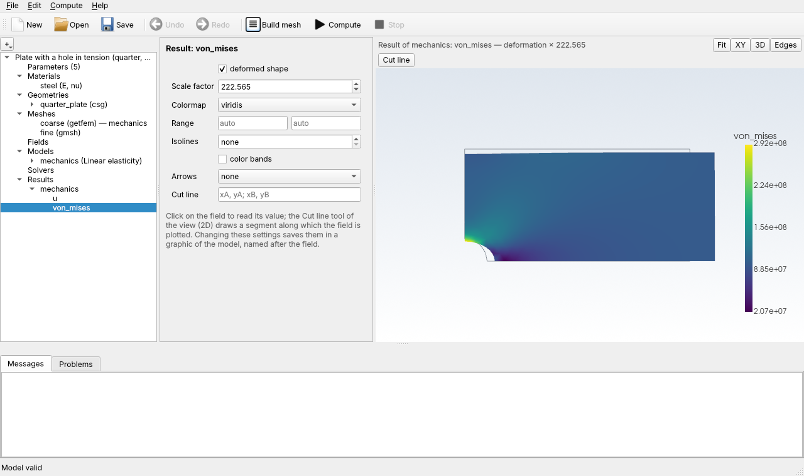

.. include:: ../replaces.txt

.. _gui-results:

Results
========

After a solve, the *Results* node lists the models, then their fields; its
form shows a table of the results (the outputs of the models). With a
result field selected, its form sets:

* the component (or the magnitude) of a vector field;
* the deformed shape, with its scale factor (displacements);
* the colormap and the color range (empty bounds: the range of the values);
* isolines, evenly spaced in the range, and color bands;
* the edges of the elements over the field (*mesh edges*, also the **Edges**
  button of the view);
* arrows of a vector field, on a regular grid, of a length proportional to
  the magnitude;
* a cut line.

A click on a 2D field shows its value under the toolbar of the view. The
**Cut line** tool draws a segment A → B (it can also be typed in the form):
the field is plotted along it under the view (with gaps outside the
domain), and the values can be saved as a CSV file.

These settings are saved in the model file, in the **Graphics** of the
model (one per result field by default, named after it; *Add a graphic*
gives another view of a field, with bands or its own cut line, say). They
come back when the file is reopened, and changing them does not make the
results out of date.

Results in time (a ``transient`` solver, see :ref:`gui-models`) show the
last saved time first; a **time bar** under the view chooses another one
(the slider, or *Play*: one after the other), for every field and graphic.
The table of the *Results* node then gives the values at that time, and
*In time* plots a scalar result (an output, an extremum) against the time.

The fields are also in the |vtu| files of the working folder, to be opened
with ParaView, for instance; in time, one per saved time, gathered by a
``.pvd`` collection.

Exporting the view
^^^^^^^^^^^^^^^^^^

**File → Export the view...** (or the **Export** button of the view) writes
what the view shows (a field, a mesh, a geometry). A dialog asks first for
the format (PNG by default), for an image or vector graphics, and for the
pixel density of an image (with the size in pixels it gives), then for the
file:

- *image* (PNG, JPEG, TIFF, or a PDF, SVG or EPS holding the image; the
  default, a PDF included), at the pixel density chosen (300 dpi by
  default, a pixel of the view counting for 1/96 inch), the page of a PDF
  having the size of the view. PNG is lossless and keeps the edges and the
  lines sharp; JPEG gives smaller files of photographs rather;
- *vector* (PDF if asked, SVG, EPS, PostScript: their default), for the
  exceptions where a document needs it: the view drawn again by matplotlib.
  A 2D view in its plane (the field with smooth colors, the edges, the
  isolines, the color bar and the title); a 3D view as seen by its camera,
  the faces shaded and sorted from the farthest (painter's algorithm), the
  faces turned away and the hidden edges left out, on a white background,
  with the color bar and the title.

The choices are kept for the next export.
