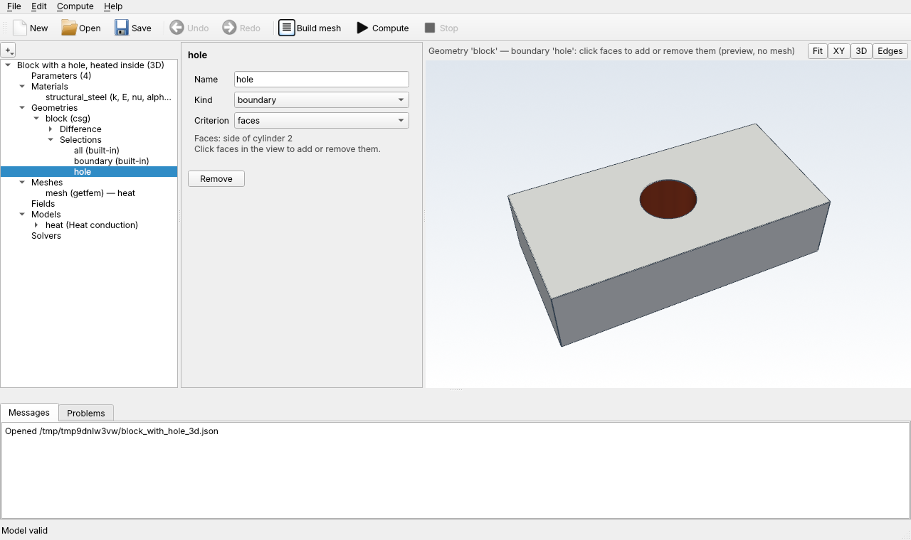

.. include:: ../replaces.txt

.. highlight:: json

.. _gui-selections:

Selections
==========

A selection is a named part of a geometry: a **boundary** selection (faces
of elements on the boundary) or a **domain** selection (elements). The
properties, sources, conditions, terms and outputs of the models are given
on selections.

``all`` (the whole domain) and ``boundary`` (the whole boundary) always
exist; a box adds its sides ``xmin``, ``xmax``... ; a curve its ends
``start`` and ``end``; a ``.msh`` file its named physical groups. The other
selections are defined by a criterion, evaluated *on the mesh*: they do not
depend on the mesher and survive remeshing. An empty selection is an error.

Criteria
--------

The criteria and their fields are listed in :ref:`gui-ref-selections`:

``plane``
   the boundary faces lying in a plane (a point and a normal);
``normal``
   the boundary faces whose outward normal is close to a direction. Beware:
   it includes the faces of the holes (the right side of a hole has a −x
   outward normal, like the left side of the part). For "the left side",
   use ``plane``, or pick the side;
``in_box``, ``in_ball``
   the boundary faces, or the elements, inside a box or a ball;
``physical``
   a physical group of an imported mesh;
``union``
   the union of selections of the same kind;
``edges`` (2D)
   sides of the primitives, as picked in the view;
``faces`` (3D)
   faces of the primitives, as picked in the view;
``regions`` (2D)
   the elements in some regions of the domain, as picked in the view.

Picking edges
-------------

With a boundary selection of a 2D box or ``csg`` geometry selected,
**clicking an edge adds or removes it** (the left button still pans the
view: a click is a press and release without moving). The picked edges are
stored as sides of primitives::

  {"type": "edges", "edges": [{"shape": [1], "side": "circle"}]}

``shape`` is the path of the primitive in the tree (the indices in the
``of`` lists of the booleans, here the second shape of the root), ``side``
the name of its side. A selection thus follows the changes of the
geometry: a parameter for the radius of the hole, a vertex inserted in a
polygon. Only the part of a side on the boundary of the domain counts.

The same holds with a boundary condition, a term or an output on a boundary
selected: clicking edges edits its support directly. Its selection is
modified in place if it is an ``edges`` selection used by this item only;
otherwise a new selection is created from the current support (named after
the item, e.g. ``traction_3``), leaving the previous one to the other items
that use it.

.. _gui-selections-regions:

Subdomains and regions
----------------------

The sides of the primitives that lie inside the domain (the circle of an
inclusion united with a plate) are drawn as thin lines: they cut the domain
into *regions*, each one given by the primitives that contain it ("in
rectangle 1 and in ball 2"). With a domain selection, a material, a source
or an output on a domain selected, the region under the mouse is
highlighted, and **clicking a region adds or removes it**, with the same
rules as for edges (a material on ``all`` gets a new selection named after
it)::

  {"type": "regions", "regions": [[[0], [1]]]}

An element belongs to the region of its center. The |gf| mesher follows the
interfaces between the regions (it is given fixed points along them), so
that a material jump is represented exactly; |gmsh| does not yet (the
region is then a staircase of elements). See
``examples/plate_inclusion.json``.

.. _gui-selections-faces:

Picking faces in 3D
-------------------

With a boundary selection of a 3D box or ``csg`` geometry selected, or an
item on a boundary, the face under the mouse is highlighted and a click adds
or removes it (a ``faces`` selection, created for the item as for 2D
edges)::

  {"type": "faces", "faces": [{"shape": [1], "face": "side"}]}

A face is a face of a primitive, stored by reference; the face swept by a
side of the profile of an extrusion or a revolution also gives the side of
the profile::

  {"shape": [0], "face": "side", "profile": {"shape": [1], "side": "circle"}}

On the mesh, the boundary faces whose vertices lie on the face of the
primitive (and whose normal agrees) are taken.
