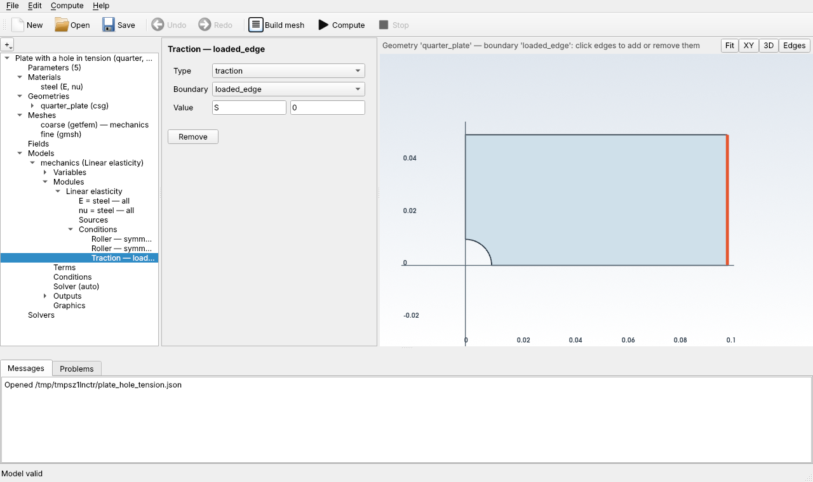

.. include:: ../replaces.txt

.. highlight:: bash

.. _lab-intro:

Introduction and installation
=============================

What it is
----------

GetFEM Lab (``getfem_lab``) is a pure |py| package. A model is a file in the JSON
format which follows the logic of |gf|: shared definitions (parameters,
materials, geometries, meshes, fields), then *models*, each of them a
``gf.Model`` with its variables, modules (predefined physics), weak form
terms and conditions, then global solvers chaining the models. The
interface edits this file; two steps, each in a separate process, compute
from it:

* the *meshing*: a generated script builds each mesh (with the |gf|
  mesher, |gmsh| or Netgen) and evaluates the named selections on it, which
  become |gf| regions;
* the *solve*: a generated |gf| script loads the meshes, builds the models,
  solves them and writes the results (integrated quantities, |vtu| files).

Requirements
------------

* |py| 3 (tested with 3.13) and |np|;
* the ``getfem`` |py| module (see :doc:`../install/install_linux`).
  Some features need recent additions to the |gf| mesher: polygons, ellipses,
  extrusions and revolutions of 2D objects (an error message says so when
  the installed |gf| lacks them);
* for the window: PySide6, and PyVista (with VTK) for the 3D view
  (``pip install pyside6 pyvista``; on Debian, the packages
  ``python3-pyside6.*`` and ``python3-pyvista``). The 3D view is the Qt
  widget of VTK itself (pyvistaqt is not needed). The command line does
  not need them;
* optional: |gmsh| (``pip install gmsh``), the default mesher of the
  constructive and CAD geometries, also used to read CAD files and to export
  geometries as STEP, IGES or BREP; Netgen (``pip install netgen-mesher``).

The package is neither compiled nor installed by the build of |gf|: it is
run from the ``lab`` directory of the sources, or installed with ``pip``
from there, which gives the command ``getfem_lab``::

  pip install -e lab              # from the sources of GetFEM (editable: the examples
                                  # and the library of materials stay where they are)
  pip install -e "lab[window]"    # with PySide6 and PyVista

Starting
--------

::

  # the getfem module must be importable, e.g. after a build:
  export PYTHONPATH=<prefix>/lib/python3.X/site-packages
  getfem_lab                                       # the window, an empty project
  getfem_lab lab/examples/plate_hole_tension.json  # with a model
  getfem_lab run lab/examples/plate.json -w /tmp/plate   # without window

Without installing it, ``python -m getfem_lab`` from the ``lab`` directory
does the same (``python -m getfem_lab examples/plate.json``).

Without a file (and with *File ▸ New*), the window opens an empty project:
no geometry, no mesh, no model. The status bar gives the next step (a
geometry, then a mesh of it, then a model on the mesh); *Add a mesh* is
offered once there is a geometry, *Add a model* once there is a mesh. An
empty project is valid, but there is nothing to compute: *Build mesh* and
*Compute* say what is missing. ``getfem_lab new model.json`` writes a
starting model instead (heat conduction on the unit square).

``--python /path/to/python`` selects the interpreter that runs the
computations (the one that provides |gf|, |gmsh| and Netgen), when it is not
the one of the interface. A start-up window shows the versions of the
interface and of |gf| (``--no-splash``, or the environment variable
``GETFEM_LAB_NO_SPLASH``, removes it).

Icon and launcher
-----------------

The interface has its own icon (a tripod in plane elasticity, computed by the
interface itself: ``lab/tools/make_icon.py`` rebuilds it), which is also the
mark of the logo of |gf| (``lab/tools/make_logo.py`` builds the logo, its
letters "FEM" meshed in quadrangles, triangles and both, for the
documentation, the Scilab help and the start-up window). The icon is shown
by the bar of the running applications:

* on macOS, the Dock shows it while the interface runs. The name in the
  menu bar and under the icon is "GetFEM Lab" when ``pyobjc`` is installed
  (``pip install pyobjc-framework-Cocoa``), "Python" otherwise;
* on Linux, the window manager receives it with the windows. The dash of
  GNOME (Ubuntu) shows the icon of the *desktop file* of the application:
  ::

    getfem_lab install-desktop [--python /path/to/python]
    getfem_lab install-desktop --uninstall

  writes ``~/.local/share/applications/getfem-lab.desktop`` and the icons
  in ``~/.local/share/icons/hicolor``. The interface is then also among
  the applications (it can be pinned to the dash), and opens as it is
  started now: the same interpreter, the same ``PYTHONPATH`` (where
  ``getfem`` is found), and the package from the same place. Run it again
  when one of them changes. The desktop file finds the windows by their
  class ``GetFEM Lab`` (X11) or their identifier ``getfem-lab``
  (Wayland).

The tests of the interface are in ``lab/tests`` (``python -m pytest tests``,
also run by ``make check``, or ``make -C lab check`` for them only);
those of the window run without a screen.

Environment variables
---------------------

``GETFEM_LAB_DEFAULT_MESHER``
   mesher of the new meshes of the constructive and CAD geometries
   (default ``gmsh``; ``getfem`` without |gmsh|).
``GETFEM_LAB_MATERIALS``
   the file of your own material library (default
   ``~/.config/getfem_lab/materials.json``).
``GETFEM_LAB_NO_SPLASH``
   no start-up window (as ``--no-splash``).
``GETFEM_LAB_WAYLAND``
   under Wayland (Linux), keeps Qt's Wayland platform. By default the
   interface uses Qt's X11 platform there (through XWayland), when it
   works: the 3D view is VTK's widget, which renders in an X window, and
   under Wayland it would open apart (the frame of the interface empty).
   Qt's X11 platform needs ``libxcb-cursor0`` (Ubuntu: ``sudo apt install
   libxcb-cursor0``). ``QT_QPA_PLATFORM``, if set, is used as is.
``GETFEM_LAB_GL_INFO``
   prints what the OpenGL driver gives to the 3D view (depth buffer,
   samples, capabilities), at its first rendering (display problems).
``GETFEM_LAB_NO_3D``
   replaces the 3D view by a placeholder (tests).
``GETFEM_LAB_OFFSCREEN_3D``
   draws the 3D view off screen (tests, screenshots).
