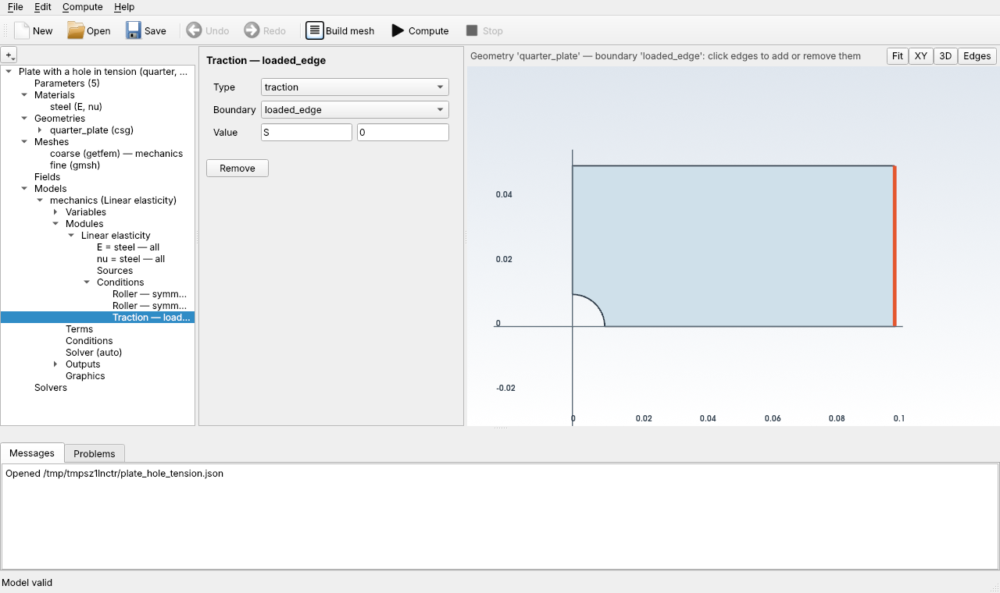

.. include:: ../replaces.txt

.. _lab-window:

The window
==========

The window has four parts:

* the **model tree** (left) shows every part of the model, in the order of
  the file: Parameters, Materials, Geometries (with their shapes and
  selections), Meshes, Fields, Models (with their Variables, Modules, Terms,
  Conditions, Solver, Outputs, Plots, Graphics), Solvers, then Results. A node with a
  problem carries a warning icon; its message is in the tooltip and in the
  *Problems* tab;
* the **properties** form (middle) of the selected node. It is built from the
  description of the model (modules, meshers, criteria), so that each kind of
  node has the fields listed in the :ref:`reference <lab-reference>`. Values
  are numbers or expressions; vectors are edited per component;
* the **view** (right): the geometry, a mesh or a result, with the part that
  the selected node concerns highlighted (in the picture, the edge where a
  traction is applied). Its buttons fit the view, look along z (*XY*) or in
  3D, and show the element edges;
* the **messages** of the meshing and of the solve, and the **problems** of
  the model (a double click selects the node concerned).

Editing
-------

* A right click on a node lists its actions; the **+** button above the tree
  lists what can be added to the selected node (a geometry, a selection, a
  model from a module, a module, a term, a condition...). Actions also
  appear as buttons under the form.
* Every change can be undone and redone (*Edit* menu).
* Changes are consistent: renaming a selection, a parameter or a material
  renames its uses; changing the type of a condition resets its fields;
  removing a shape updates the selections that refer to its sides.
* The parameters are edited together, in a table (name, value or
  expression, its value, description); rows are added, removed and moved (a
  parameter may only use the ones above it).

Computing
---------

**Build mesh** (F7) builds the meshes, **Compute** (F8) builds them if needed,
checks the expressions and solves; **Stop** interrupts them. Both run in a
separate process, whose output appears in *Messages*. After a solve, the
*Results* node lists the models and their fields (see :ref:`lab-results`).

Menus
-----

*File*
   new, open (and the examples), save, export of a geometry or a mesh
   (:ref:`lab-export`), export as a standalone |py| script.
*Edit*
   undo, redo.
*Compute*
   build the meshes, compute, stop, show the solve script, open the working
   folder.
*Help*
   about, license.
